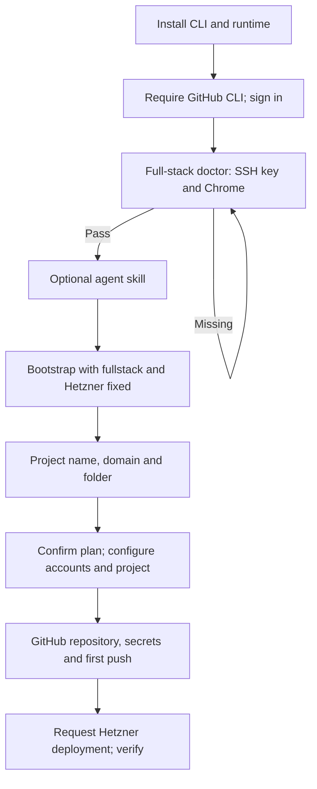
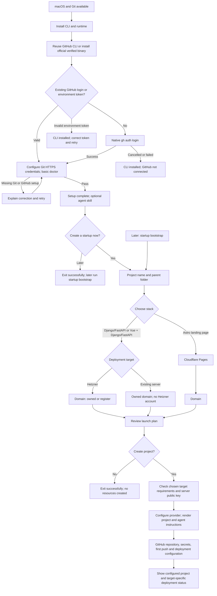

# Optional startup onboarding

The installer finishes CLI/GitHub setup before offering to create a project.
Project creation then asks for a name, folder, stack and compatible deployment
target. An SSH key or cloud account cannot block installation completion.

## Before

## After

## Behavior and compatibility

- Plain `startup doctor` checks Git, Git identity, GitHub CLI/auth/scopes and uv.
  Add `--provider hetzner` or `--provider byos` for deployment prerequisites.
  Chrome is checked for the Hetzner browser path, not BYOS/basic setup.
- `startup bootstrap` asks for name/folder before the stack and target. Built-in
  templates use pinned releases: Django/FastAPI v0.1.6, Vue v0.1.5, Astro v0.1.1.
  Existing explicit flags remain supported; `--kind fullstack` bypasses the
  picker and keeps the Django/FastAPI default. `--yes` stays unattended.
- Server keys are separate from GitHub OAuth/tokens and generated CI keys.
  `--ssh-public-key <path.pub>` supports custom paths. New projects select and
  validate the operator public key before any provider resources are created.
  Invalid/private key files are rejected without printing their contents.
- BYOS asks for an owned domain. Ordinary BYOS rejects `--buy-domain` rather
  than silently ignoring it. The existing shared-cluster domain-order path is
  preserved.
- Installation failure, incomplete GitHub setup and project failure are distinct.
  Existing projects are preserved. Rerun bootstrap using the same name, parent
  folder, stack and provider; this change does not add a new resume database.
- Deployment behavior remains target-specific: Hetzner keeps its Actions/DNS/TLS
  health verification; BYOS prints the existing server setup/deploy commands;
  Astro uses its existing Cloudflare flow. A configured project is not reported
  as a verified live application.

## Rollout across repositories

1. Merge and publish a tested CLI release containing this change.
2. Advance the website installer's fixed CLI pin to that published release using
   the existing release updater.
3. Merge the companion website/installer change only after that pin advances.
   The installer checks for the new doctor interface and refuses to run the old
   full-stack prerequisite loop with an incompatible CLI.
4. Verify the live installer and first-time onboarding on macOS. Existing CLI
   installations update only when their owners rerun the installer.

No unpublished CLI tag is invented in either change. Browser OAuth, Keychain,
macOS binary execution and real cloud deployment still require separate live
verification; local boundary tests do not establish those outcomes.
