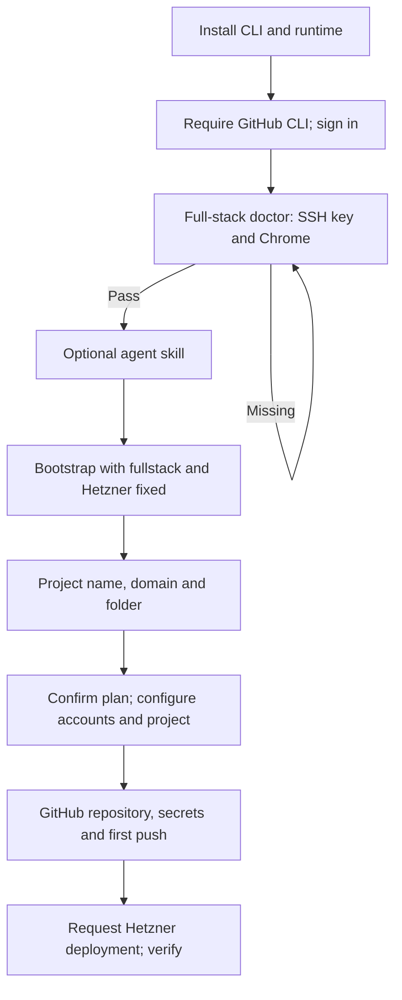
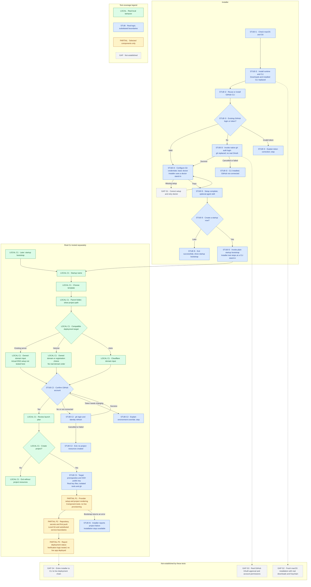

# Optional startup onboarding

The installer finishes CLI/GitHub setup before offering to create a project.
Project creation asks for a name, template, parent folder, compatible deployment
target, GitHub account confirmation and final approval, in that order. An SSH
key or cloud account cannot block installation completion.

## Before

## After — flow and test coverage

The labels describe **what was exercised**, not a percentage of coverage.
A passing check with a stand-in does not prove the corresponding live service.
The historical **Before** diagram above has no coverage classification.

- **LOCAL / green:** real local CLI behavior or files were checked.
- **STUB / blue:** real installer/CLI logic was checked with external commands or services replaced.
- **PARTIAL / amber:** component scenarios exist; the whole depicted phase is not verified end to end.
- **GAP / gray:** no matching automated scenario or live qualification is established.

Dotted arrows point to missing evidence, not additional setup steps. The labels
remain meaningful without color. **HANDOFF is a test boundary:** the installer
and CLI suites do not constitute one continuous real installation/deployment
scenario. The failure arrow illustrates the installer's handling of a failing
bootstrap exit code; the installer fixture supplies that failure without running
a real provider step. Other bootstrap failures use the same handler.

## Evidence for the diagram

These links pin the test implementations used for the coverage assessment.
The green CI results establish only the executed scenarios below; they do not
turn the GAP nodes into verified steps.

| Label | What is actually checked | Boundary or remaining gap | Evidence |
| --- | --- | --- | --- |
| I1 | Unsupported platform, missing Git, invalid arguments and missing interactive terminal stop installation with guidance. | Platform/tool detection is simulated; this is not a fresh Mac. | [Installer failure scenarios](https://github.com/philipp-lein/deploy-your-startup-website/blob/b76becc/tests/test_installer.py) |
| I2 | Real Bash script creates its launcher/runtime layout, uses the managed runtime, handles missing gh and rejects a bad archive checksum. | Downloads, uv installation, gh archive extraction and the installed CLI are replaced. The successful-download checksum path uses a stand-in; bad-checksum rejection uses real shasum. Actual Python/CLI/gh installation on macOS is unverified. | [Installer terminal tests and download fixtures](https://github.com/philipp-lein/deploy-your-startup-website/blob/b76becc/tests/test_installer_agent_skill.py) |
| I3 | Existing login/token reuse, native login invocation, Git credential setup invocation, cancelled login and invalid-token handling. | Fake gh supplies outcomes; no GitHub OAuth approval or real permissions are exercised. | Same installer suite: `test_environment_token_reuses_authentication`, `test_new_login_uses_github_cli`, cancelled-login and invalid-token scenarios. |
| I4 | An incompatible old CLI is rejected; the compatible CLI's doctor is invoked before setup completion. | The installer fixture's doctor always succeeds. The correction/retry loop is G1. The real doctor is checked separately in C3. | Same installer suite: `test_old_cli_release_cannot_enter_the_incompatible_flow`; `STARTUP` fixture. |
| I5 | Setup completion, optional skill acceptance/decline, Later without bootstrap, and Create now without forced template/provider flags. | Skill/bootstrap commands are substitutes inside installer tests. Real skill file installation has separate CLI tests. | Same installer suite: `test_later_finishes_setup_without_starting_a_project`, `test_onboarding_lets_the_cli_ask_about_the_domain`, skill scenarios; [real skill installation tests](https://github.com/Deploy-your-Startup/cli/blob/6acb2d6/tests/test_agent_skill_integration.py). |
| I6 | A nonzero bootstrap exit preserves the installed launcher and reports project failure separately from installation success. | Does not demonstrate preservation/recovery of a partially created real cloud project. | Same installer suite: `test_failed_project_setup_keeps_successful_installation_distinct`. |
| C1 | Real CLI processes exercise question order, all three templates, compatible targets, domain input, validation, summary and cancellation without project creation. | Planning/cancellation coverage does not establish successful provisioning. | [Onboarding integration tests](https://github.com/Deploy-your-Startup/cli/blob/6acb2d6/tests/test_onboarding_integration.py) |
| C2 | Real CLI confirms the current account, refreshes the owner after login, handles failed/incomplete login and token overrides, and updates the plan. | The gh executable is a local stand-in with account state. | Same onboarding suite: `test_complete_question_order_confirms_github_before_creation` and GitHub scenarios. |
| C3 | Real doctor output, target-specific prerequisites, real OpenSSH key validation, custom paths and rejection of malformed/private files. | Tool availability/gh are controlled; no live server access is established by these checks. | [Doctor tests](https://github.com/Deploy-your-Startup/cli/blob/6acb2d6/tests/test_doctor_integration.py), [SSH key tests](https://github.com/Deploy-your-Startup/cli/blob/6acb2d6/tests/test_ssh_key_selection_integration.py) |
| P1 | Selected provider price/domain scenarios, real project rendering, encryption and resume behavior. | Separate component scenarios with local services/stand-ins; not every template/provider combination or complete wizard is covered. | [Price tests](https://github.com/Deploy-your-Startup/cli/blob/6acb2d6/tests/test_bootstrap_cost_integration.py), [domain browser tests](https://github.com/Deploy-your-Startup/cli/blob/6acb2d6/tests/test_domain_order_integration.py), [project-generation tests](https://github.com/Deploy-your-Startup/cli/blob/6acb2d6/tests/test_kpis_bootstrap_integration.py) |
| P2 | Selected local Git/sync and GitHub secret-transport behavior, including redaction on failure. | Does not establish real repository creation, secret permissions and first push as one complete bootstrap transaction. | [Git sync tests](https://github.com/Deploy-your-Startup/cli/blob/6acb2d6/tests/test_sync_source_version_integration.py), [secret-transport test](https://github.com/Deploy-your-Startup/cli/blob/6acb2d6/tests/test_bootstrap_github_secret.py) |
| P3 | Verification accepts successful Actions/DNS/health responses and rejects failed or mismatched responses. | gh and DNS are substituted; health HTTP is local and TLS failure is injected. No public HTTPS application is deployed by this test. | [Verification tests](https://github.com/Deploy-your-Startup/cli/blob/6acb2d6/tests/test_verification_integration.py) |
| G1–G4 | No completion claim. | Doctor correction/retry; fresh macOS downloads/Keychain; real GitHub OAuth/permissions; a continuous install-to-live-deploy scenario remain unverified. | G1 follows directly from the installer fixture; the other gaps are outside the cited suites. |

The website's [browser tests](https://github.com/philipp-lein/deploy-your-startup-website/blob/b76becc/e2e_tests/tests/site.spec.ts)
check visible instructions and the landing-page option against the built site.
They do **not** execute the shell installer from the browser.

Evidence baseline: [CLI CI at 6acb2d6](https://github.com/Deploy-your-Startup/cli/actions/runs/38585283233)
passed with 376 tests and 2 macOS-related skips; [website CI at b76becc](https://github.com/philipp-lein/deploy-your-startup-website/actions/runs/38584960281)
passed installer/page checks and browser tests. This is a scenario inventory,
not a measured statement/branch coverage percentage.

## Behavior and compatibility

- Plain `startup doctor` checks Git, Git identity, GitHub CLI/auth/scopes and uv.
  Add `--provider hetzner` or `--provider byos` for deployment prerequisites.
  Chrome is checked for the Hetzner browser path, not BYOS/basic setup.
- `startup bootstrap` asks for name, template, parent folder, deployment target,
  GitHub account confirmation and final approval. Built-in
  templates use pinned releases: Django/FastAPI v0.1.7, Vue v0.1.6, Astro v0.1.2.
  Existing explicit flags remain supported; `--kind fullstack` bypasses the
  picker and keeps the Django/FastAPI default. `--yes` stays unattended.
- GitHub confirmation shows the signed-in username and proposed repository.
  Declining runs native `gh auth login`, configures Git credentials, then asks
  again using the newly authenticated identity. Missing authentication also
  starts native login. Environment tokens are reused, never silently removed;
  changing their account requires updating/unsetting `GH_TOKEN`/`GITHUB_TOKEN`.
  `--github-username` preserves an explicit owner/organization without another
  account prompt; `--yes` remains unattended. No project/provider resources are
  created before final approval. Login may update the local credential store.
- Server keys are separate from GitHub OAuth/tokens and generated CI keys.
  `--ssh-public-key <path.pub>` supports custom paths. New projects select and
  validate the operator public key before any provider resources are created.
  Invalid/private key files are rejected without printing their contents.
- BYOS asks for an owned domain. Ordinary BYOS rejects `--buy-domain` rather
  than silently ignoring it. The existing shared-cluster domain-order path is
  preserved.
- Installation failure, incomplete GitHub setup and project failure are distinct.
  Existing projects are preserved. Rerun bootstrap using the same name, parent
  folder, stack and provider; this change does not add a new resume database.
- Deployment behavior remains target-specific: Hetzner keeps its Actions/DNS/TLS
  health verification; BYOS prints the existing server setup/deploy commands;
  Astro uses its existing Cloudflare flow. A configured project is not reported
  as a verified live application.

## Rollout across repositories

1. Merge and publish a tested CLI release containing this change.
2. Advance the website installer's fixed CLI pin to that published release using
   the existing release updater.
3. Merge the companion website/installer change only after that pin advances.
   The installer checks for the new doctor interface and refuses to run the old
   full-stack prerequisite loop with an incompatible CLI.
4. Verify the live installer and first-time onboarding on macOS. Existing CLI
   installations update only when their owners rerun the installer.

No unpublished CLI tag is invented in either change. Browser OAuth, Keychain,
macOS binary execution and real cloud deployment still require separate live
verification; local boundary tests do not establish those outcomes.
